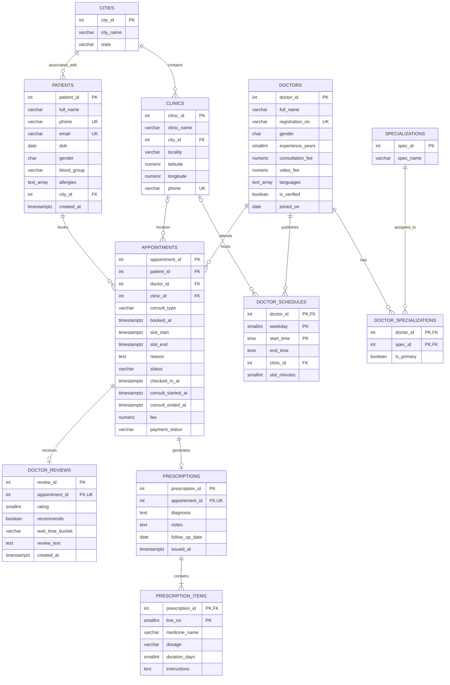

# Practo Doctor Appointments Database
## 02. Database Schema Design and Data Analysis

### 1. Database Overview

#### 1.1 Purpose and Design Approach

The objective of this phase is to reconstruct the Practo Doctor Appointments relational database from the 11 supplied CSV exports. The original database schema is not available, so the design is derived from the actual column structures, record values, missing-value patterns, candidate keys, inter-table relationships and business rules represented in the supplied data.

The database is designed using PostgreSQL, with an emphasis on relational integrity, appropriate data types, meaningful constraints and a structure that supports both operational healthcare workflows and analytical reporting.

The schema follows a relational design in which reference entities, such as cities and medical specializations, are stored separately from transactional entities, such as appointments and prescriptions. This separation reduces unnecessary data duplication and provides consistent relationships across the platform.

The design also considers the supplied 30-query workload. Column names and source table names are preserved to maintain compatibility with the prescribed SQL queries.

#### 1.2 Dataset Profile

The uploaded production export contains **626,367 records across 11 tables**.

| Table | Records | Columns | Purpose |
|---|---:|---:|---|
| cities | 10 | 3 | Geographic reference data |
| specializations | 15 | 2 | Medical specialization reference data |
| doctors | 3,000 | 10 | Doctor profiles and professional information |
| doctor_specializations | 3,700 | 3 | Doctor-to-specialization relationships |
| clinics | 1,500 | 7 | Clinic details and geographic information |
| doctor_schedules | 30,499 | 6 | Recurring weekly doctor availability |
| patients | 40,000 | 10 | Patient profiles and medical information |
| appointments | 150,000 | 15 | Appointment bookings and consultation outcomes |
| prescriptions | 97,234 | 6 | Diagnoses and prescription records |
| prescription_items | 243,085 | 6 | Individual medicines and dosage instructions |
| doctor_reviews | 30,339 | 7 | Patient feedback and consultation ratings |
| **Total** | **626,367** | **75** | **Complete source dataset** |

The appointment records are central to the model. They connect patients, doctors and clinics and provide the foundation for consultation history, prescription retrieval, reviews, payment reporting and operational monitoring.

#### 1.3 Data Profiling Methodology

The data analysis was performed directly against all 11 uploaded CSV files. The following checks were used to establish the proposed schema:

- Column and row-count inspection for every source file.
- Missing-value analysis for each column.
- Duplicate-record and candidate-primary-key analysis.
- Candidate natural-key uniqueness checks.
- Foreign-key reference validation across related datasets.
- Distinct-value profiling for categorical fields.
- Numeric-range and date/time validation.
- Relationship and cardinality analysis.
- Cross-table business-rule validation.
- Examination of potentially derived or redundant attributes.

The results below distinguish observed properties of this particular export from proposed database rules. A value being present in the current dataset does not, by itself, establish that it is a permanent business rule.

---

### 2. Proposed Relational Schema

The database will use a dedicated PostgreSQL schema named `practo`.

```sql
CREATE SCHEMA practo;
SET search_path TO practo;
```

The 11 source tables are retained using their original names. Primary keys identify individual records, foreign keys maintain relationships, and constraints validate the business rules that can be safely enforced.

#### 2.1 Primary-Key Design

| Table | Proposed primary key | Reason |
|---|---|---|
| cities | `city_id` | Unique identifier for each city |
| specializations | `spec_id` | Unique identifier for each specialization |
| doctors | `doctor_id` | Unique identifier for each doctor |
| doctor_specializations | (`doctor_id`, `spec_id`) | Each doctor-specialization association must be unique |
| clinics | `clinic_id` | Unique identifier for each clinic |
| doctor_schedules | (`doctor_id`, `weekday`, `start_time`) | Identifies a doctor's recurring schedule entry |
| patients | `patient_id` | Unique identifier for each patient |
| appointments | `appointment_id` | Unique identifier for each appointment |
| prescriptions | `prescription_id` | Unique identifier for each prescription |
| prescription_items | (`prescription_id`, `line_no`) | Identifies each medicine line within a prescription |
| doctor_reviews | `review_id` | Unique identifier for each review |

**Important findings about composite keys:**

- `doctor_specializations` contains 3,700 rows for 3,000 doctors. A doctor can therefore have multiple specializations, so `doctor_id` alone cannot be its primary key.
- `prescription_items` can contain several medicines for one prescription. The combination of `prescription_id` and `line_no` identifies an individual medicine entry.
- `doctor_schedules` has no separate schedule identifier in the source data. The combination of `doctor_id`, `weekday` and `start_time` is unique across all 30,499 rows and contains no NULL values. It is therefore a suitable composite primary key for this export.

The schedule key intentionally excludes `clinic_id`, which can be NULL, and must not be included in a primary key.

#### 2.2 Candidate Natural Keys and UNIQUE Constraints

The following attributes were also tested for uniqueness:

| Table | Candidate attribute | Profiling result | Proposed treatment |
|---|---|---|---|
| doctors | registration_no | 3,000 distinct non-NULL values | UNIQUE |
| patients | phone | 40,000 distinct values | UNIQUE |
| patients | email | 26,060 distinct non-NULL values | UNIQUE, nullable |
| clinics | phone | 1,500 distinct values | UNIQUE |
| specializations | spec_name | 15 distinct values | UNIQUE |
| prescriptions | appointment_id | 97,234 distinct values | UNIQUE |
| doctor_reviews | appointment_id | 30,339 distinct values | UNIQUE |

A UNIQUE constraint on `patients.email` is compatible with missing email values in PostgreSQL because ordinary UNIQUE constraints permit multiple NULL values. This preserves the source data while preventing duplicate non-NULL email addresses.

City names are distinct in the supplied export, but `city_id` remains the preferred identifier because a city name alone is not a globally reliable identifier across different states or regions.

---

### 3. Data Dictionary and Column-Level Design

The following data dictionary records the proposed PostgreSQL type, nullability, constraint and design rationale for every source column.

#### 3.1 `cities`

**Purpose:** Stores the city reference information used by patients and clinics.

| Column | Proposed type | Constraint | Design justification |
|---|---|---|---|
| city_id | INTEGER | PRIMARY KEY, NOT NULL | Stable identifier for each city |
| city_name | VARCHAR(100) | NOT NULL | Human-readable city name |
| state | VARCHAR(100) | NOT NULL | State or regional classification |

**Relationship:** One city can be associated with many patients and many clinics.

**Functional dependency:** `city_id → city_name, state`

#### 3.2 `specializations`

**Purpose:** Maintains a controlled list of medical specializations.

| Column | Proposed type | Constraint | Design justification |
|---|---|---|---|
| spec_id | INTEGER | PRIMARY KEY, NOT NULL | Unique specialization identifier |
| spec_name | VARCHAR(100) | UNIQUE, NOT NULL | Prevents duplicate specialization names |

**Relationship:** One specialization can be associated with multiple doctors through `doctor_specializations`.

**Functional dependency:** `spec_id → spec_name`

#### 3.3 `doctors`

**Purpose:** Stores professional and profile information for doctors registered on the platform.

| Column | Proposed type | Constraint | Design justification |
|---|---|---|---|
| doctor_id | INTEGER | PRIMARY KEY, NOT NULL | Unique doctor identifier |
| full_name | VARCHAR(150) | NOT NULL | Doctor's displayed name |
| registration_no | VARCHAR(20) | UNIQUE, NOT NULL | Professional registration reference |
| gender | CHAR(1) | CHECK, NOT NULL | Source values are M and F |
| experience_years | SMALLINT | CHECK, NOT NULL | Whole-number experience value |
| consultation_fee | NUMERIC(10,2) | CHECK, NOT NULL | Monetary consultation charge |
| video_fee | NUMERIC(10,2) | CHECK, NULL | Optional video consultation fee |
| languages | TEXT[] | CHECK, NOT NULL | Supports multiple languages per doctor |
| is_verified | BOOLEAN | NOT NULL | Indicates professional verification |
| joined_on | DATE | NOT NULL | Doctor's platform joining date |

**Profiling observations:**

- 3,000 doctors are present.
- All 3,000 registration numbers are distinct.
- Doctor gender values are `M` and `F`.
- Experience ranges from 1 to 38 years.
- Consultation fees range from ₹300 to ₹1,500.
- Video fees range from ₹200 to ₹1,400 among the non-NULL records.
- `video_fee` is missing for 894 doctors.
- All 3,000 language values are represented as PostgreSQL-style arrays.

The `languages` column uses `TEXT[]` because the supplied search workload uses PostgreSQL array operations, including `ANY()`.

**Functional dependency:** `doctor_id → full_name, registration_no, gender, experience_years, consultation_fee, video_fee, languages, is_verified, joined_on`

The registration number is an alternate candidate key in this export.

#### 3.4 `doctor_specializations`

**Purpose:** Resolves the many-to-many relationship between doctors and specializations.

| Column | Proposed type | Constraint | Design justification |
|---|---|---|---|
| doctor_id | INTEGER | PRIMARY KEY (composite), FK, NOT NULL | References the doctor |
| spec_id | INTEGER | PRIMARY KEY (composite), FK, NOT NULL | References the specialization |
| is_primary | BOOLEAN | NOT NULL | Identifies the doctor's primary specialization |

**Profiling observations:**

- 3,700 doctor-specialization associations are present.
- All 3,000 doctors have at least one specialization.
- 700 doctors have two specializations.
- Every doctor has exactly one primary specialization in the supplied records.
- No doctor has multiple primary specializations in the export.

**Primary key:** `(doctor_id, spec_id)`

**Functional dependency:** `(doctor_id, spec_id) → is_primary`

`doctor_id` alone cannot determine `spec_id`, because multiple specializations are permitted.

**Primary specialization enforcement:** The rule that a doctor may have at most one primary specialization is a cross-row rule. PostgreSQL cannot express it as a normal row-level CHECK constraint. A partial unique index on `doctor_id` with the condition `WHERE is_primary` is the appropriate integrity mechanism:

```sql
CREATE UNIQUE INDEX uq_doctor_one_primary_specialization
ON doctor_specializations (doctor_id)
WHERE is_primary;
```

This is an integrity-enforcing unique index, not a performance-tuning index. It should be documented as an explicit exception to the general instruction to defer performance indexes. The requirement that every doctor has at least one primary specialization must also be validated across the loaded dataset.

#### 3.5 `clinics`

**Purpose:** Stores clinic identity, location and contact information.

| Column | Proposed type | Constraint | Design justification |
|---|---|---|---|
| clinic_id | INTEGER | PRIMARY KEY, NOT NULL | Unique clinic identifier |
| clinic_name | VARCHAR(150) | NOT NULL | Clinic's displayed name |
| city_id | INTEGER | FK, NOT NULL | References the city |
| locality | VARCHAR(120) | NOT NULL | Local area within the city |
| latitude | NUMERIC(9,6) | CHECK, NOT NULL | Geographic latitude |
| longitude | NUMERIC(9,6) | CHECK, NOT NULL | Geographic longitude |
| phone | VARCHAR(20) | UNIQUE, NOT NULL | Contact number |

**Profiling observations:**

- 1,500 clinics are present.
- All clinic city references point to existing city records.
- All 1,500 clinic phone numbers are distinct.
- Latitude values range from approximately 12.873439 to 28.713249.
- Longitude values range from approximately 72.477641 to 88.463469.

Latitude and longitude use NUMERIC rather than floating-point types to preserve the supplied decimal precision.

**Functional dependency:** `clinic_id → clinic_name, city_id, locality, latitude, longitude, phone`

The clinic phone is an alternate candidate key in the supplied export.

#### 3.6 `doctor_schedules`

**Purpose:** Represents the recurring weekly working schedule of each doctor, including physical clinic availability and video consultation availability.

| Column | Proposed type | Constraint | Design justification |
|---|---|---|---|
| doctor_id | INTEGER | PRIMARY KEY (composite), FK, NOT NULL | References the scheduled doctor |
| weekday | SMALLINT | PRIMARY KEY (composite), CHECK, NOT NULL | Identifies the day of the week |
| start_time | TIME | PRIMARY KEY (composite), NOT NULL | Beginning of the schedule |
| end_time | TIME | CHECK, NOT NULL | End of the schedule |
| clinic_id | INTEGER | FK, NULL | Physical clinic; NULL represents video availability in this model |
| slot_minutes | SMALLINT | CHECK, NOT NULL | Duration of each appointment slot |

**Primary key:** `(doctor_id, weekday, start_time)`

**Profiling observations:**

- 30,499 schedule records are present.
- All schedule doctor references are valid.
- 5,899 records have a NULL `clinic_id`.
- The other 24,600 records reference existing clinics.
- Weekday values in the export range from 1 to 6.
- Slot durations are 10, 15 or 20 minutes.
- Every schedule has a start time earlier than its end time.

A NULL `clinic_id` is consistent with video consultation availability. The supplied R02 query also interprets a missing clinic name as `Video consultation`.

The proposed weekday constraint allows values from 1 through 7. Although the current export contains 1–6, allowing 7 avoids unnecessarily restricting future Sunday schedules.

**Functional dependency:** `(doctor_id, weekday, start_time) → end_time, clinic_id, slot_minutes`

#### 3.7 `patients`

**Purpose:** Stores patient identity, contact information and medical attributes relevant to healthcare delivery.

| Column | Proposed type | Constraint | Design justification |
|---|---|---|---|
| patient_id | INTEGER | PRIMARY KEY, NOT NULL | Unique patient identifier |
| full_name | VARCHAR(150) | NOT NULL | Patient's displayed name |
| phone | VARCHAR(20) | UNIQUE, NOT NULL | Primary contact and sign-in identifier |
| email | VARCHAR(254) | UNIQUE, NULL | Optional electronic contact |
| dob | DATE | NOT NULL | Supports age-based reporting |
| gender | CHAR(1) | CHECK, NOT NULL | Source values are M, F and X |
| blood_group | VARCHAR(3) | CHECK, NULL | Optional medical information |
| allergies | TEXT[] | NULL | Multiple recorded allergies |
| city_id | INTEGER | FK, NOT NULL | References the patient's city |
| created_at | TIMESTAMPTZ | NOT NULL | Patient registration timestamp |

**Profiling observations:**

- 40,000 patient records are present.
- All patient IDs and phone numbers are unique.
- 13,940 email values are NULL.
- 3,204 blood-group values are NULL.
- 33,986 allergy values are NULL.
- Patient gender values are `M`, `F` and `X`.
- Eight blood groups are present: `A+`, `A-`, `B+`, `B-`, `AB+`, `AB-`, `O+` and `O-`.
- Non-NULL allergy arrays contain values such as Penicillin, Aspirin, Latex, Peanuts, Sulfa, Pollen and Dust.

The allergy column uses `TEXT[]` because the supplied R10 query uses PostgreSQL's array containment operator.

A NULL allergy value must not automatically be interpreted as a confirmed absence of allergies. It means that no allergy value is recorded in the supplied export.

**Functional dependency:** `patient_id → full_name, phone, email, dob, gender, blood_group, allergies, city_id, created_at`

#### 3.8 `appointments`

**Purpose:** This is the central transactional table. It connects patients, doctors and clinics and records booking, consultation, timing, status and payment information.

| Column | Proposed type | Constraint | Design justification |
|---|---|---|---|
| appointment_id | INTEGER | PRIMARY KEY, NOT NULL | Unique appointment identifier |
| patient_id | INTEGER | FK, NOT NULL | References the patient |
| doctor_id | INTEGER | FK, NOT NULL | References the doctor |
| clinic_id | INTEGER | FK, NULL | References a physical clinic; NULL for video consultation |
| consult_type | VARCHAR(12) | CHECK, NOT NULL | IN_CLINIC or VIDEO |
| booked_at | TIMESTAMPTZ | NOT NULL | Booking creation timestamp |
| slot_start | TIMESTAMPTZ | CHECK, NOT NULL | Scheduled consultation start |
| slot_end | TIMESTAMPTZ | CHECK, NOT NULL | Scheduled consultation end |
| reason | TEXT | NOT NULL | Patient's stated reason for booking |
| status | VARCHAR(16) | CHECK, NOT NULL | Appointment lifecycle status |
| checked_in_at | TIMESTAMPTZ | NULL | Physical check-in timestamp |
| consult_started_at | TIMESTAMPTZ | NULL | Actual consultation start |
| consult_ended_at | TIMESTAMPTZ | NULL | Actual consultation completion |
| fee | NUMERIC(10,2) | CHECK, NOT NULL | Recorded appointment fee |
| payment_status | VARCHAR(12) | CHECK, NOT NULL | Payment state |

**Profiling observations:**

- 150,000 appointments are present.
- Every appointment references an existing patient and doctor.
- 122,144 appointments are `IN_CLINIC`.
- 27,856 appointments are `VIDEO`.
- All in-clinic appointments have a `clinic_id`.
- All video appointments have a NULL `clinic_id`.
- Appointment fees range from ₹200 to ₹1,500.
- Slot durations are 10, 15 or 20 minutes.
- The consultation start and end timestamps are populated for completed appointments in the supplied data.

**Appointment statuses found in the CSV:**

| Status | Records |
|---|---:|
| COMPLETED | 121,409 |
| CANCELLED | 14,900 |
| NO_SHOW | 11,868 |
| BOOKED | 1,823 |
| **Total** | **150,000** |

**Payment statuses found in the CSV:**

| Payment status | Records |
|---|---:|
| PAID | 112,293 |
| PENDING | 28,828 |
| REFUNDED | 8,879 |
| **Total** | **150,000** |

The schema must also permit `CHECKED_IN`, because the prescribed W02 workload updates an appointment to this state. This is a required workflow state even though it does not occur in the initial seed CSV.

**Functional dependency:** `appointment_id → patient_id, doctor_id, clinic_id, consult_type, booked_at, slot_start, slot_end, reason, status, checked_in_at, consult_started_at, consult_ended_at, fee, payment_status`

The combination of `doctor_id` and `slot_start` is deliberately not declared UNIQUE because the supplied data contains active duplicate doctor-slot records. Those records are examined in the data-quality section.

#### 3.9 `prescriptions`

**Purpose:** Stores the diagnosis and prescription information produced after a consultation.

| Column | Proposed type | Constraint | Design justification |
|---|---|---|---|
| prescription_id | INTEGER | PRIMARY KEY, NOT NULL | Unique prescription identifier |
| appointment_id | INTEGER | UNIQUE, FK, NOT NULL | Associates one prescription with an appointment |
| diagnosis | TEXT | NOT NULL | Recorded diagnosis |
| notes | TEXT | NULL | Additional clinical notes |
| follow_up_date | DATE | NULL | Optional follow-up date |
| issued_at | TIMESTAMPTZ | NOT NULL | Prescription issue timestamp |

**Profiling observations:**

- 97,234 prescriptions are present.
- Every prescription refers to an existing appointment.
- No appointment appears more than once in this prescription export.
- 58,105 notes values are NULL.
- 68,184 follow-up dates are NULL.
- No non-NULL follow-up date occurs before the prescription issue date.

**Functional dependency:** `prescription_id → appointment_id, diagnosis, notes, follow_up_date, issued_at`

Because `appointment_id` is also unique in the supplied export, it is an alternate candidate key.

#### 3.10 `prescription_items`

**Purpose:** Stores each medicine associated with a prescription, allowing one prescription to contain multiple medicine entries.

| Column | Proposed type | Constraint | Design justification |
|---|---|---|---|
| prescription_id | INTEGER | PRIMARY KEY (composite), FK, NOT NULL | References the prescription |
| line_no | SMALLINT | PRIMARY KEY (composite), CHECK, NOT NULL | Medicine's sequence within the prescription |
| medicine_name | VARCHAR(150) | NOT NULL | Prescribed medicine |
| dosage | VARCHAR(30) | CHECK, NOT NULL | Dosage notation |
| duration_days | SMALLINT | CHECK, NOT NULL | Treatment duration |
| instructions | TEXT | NULL | Additional usage instructions |

**Primary key:** `(prescription_id, line_no)`

**Profiling observations:**

- 243,085 medicine records are present.
- All prescription references are valid.
- Line numbers range from 1 to 4.
- Dosage patterns in the export are `1-0-1`, `0-0-1`, `1-0-0` and `1-1-1`.
- Treatment duration ranges from 3 to 30 days.
- 97,233 instructions values are NULL.

**Functional dependency:** `(prescription_id, line_no) → medicine_name, dosage, duration_days, instructions`

Neither `prescription_id` nor `line_no` alone is sufficient to identify a medicine record.

#### 3.11 `doctor_reviews`

**Purpose:** Stores patient feedback about appointments, including ratings, recommendation decisions and reported waiting time.

| Column | Proposed type | Constraint | Design justification |
|---|---|---|---|
| review_id | INTEGER | PRIMARY KEY, NOT NULL | Unique review identifier |
| appointment_id | INTEGER | UNIQUE, FK, NOT NULL | Associates a review with an appointment |
| rating | SMALLINT | CHECK, NOT NULL | Rating from 1 to 5 |
| recommends | BOOLEAN | NOT NULL | Whether the patient recommends the doctor |
| wait_time_bucket | VARCHAR(12) | CHECK, NOT NULL | Categorized waiting time |
| review_text | TEXT | NULL | Optional written feedback |
| created_at | TIMESTAMPTZ | NOT NULL | Review submission timestamp |

**Profiling observations:**

- 30,339 reviews are present.
- Every review references an existing appointment.
- No appointment has multiple reviews in the supplied export.
- Ratings range from 1 to 5.
- 25,833 reviews have `recommends = true`.
- 4,506 reviews have `recommends = false`.
- 12,069 written review values are NULL.
- Waiting-time categories are `<15 min`, `15-30 min`, `30-60 min` and `>1 hr`.

**Functional dependency:** `review_id → appointment_id, rating, recommends, wait_time_bucket, review_text, created_at`

Because `appointment_id` is unique in this export, it can also be treated as an alternate candidate key.

---

### 4. NULL Analysis and Optional Attributes

NULL values must be interpreted according to the purpose of each attribute. They are not automatically errors and must not be replaced with arbitrary default values.

| Table | Column | NULL records | Percentage | Design interpretation |
|---|---|---:|---:|---|
| doctors | video_fee | 894 | 29.80% | Video fee is not recorded for some doctors |
| patients | email | 13,940 | 34.85% | Email is optional |
| patients | blood_group | 3,204 | 8.01% | Blood group is not available for some patients |
| patients | allergies | 33,986 | 84.97% | No allergy value is recorded in these rows |
| doctor_schedules | clinic_id | 5,899 | 19.34% | Represents video schedule availability in this model |
| appointments | clinic_id | 27,856 | 18.57% | Video appointments have no physical clinic |
| appointments | checked_in_at | 51,180 | 34.12% | No check-in timestamp is recorded for these records |
| appointments | consult_started_at | 28,591 | 19.06% | No actual consultation start timestamp is recorded |
| appointments | consult_ended_at | 28,591 | 19.06% | No actual consultation end timestamp is recorded |
| prescriptions | notes | 58,105 | 59.76% | Additional notes are optional |
| prescriptions | follow_up_date | 68,184 | 70.12% | Follow-up is not recorded for every prescription |
| prescription_items | instructions | 97,233 | 40.00% | Additional medicine instructions are optional |
| doctor_reviews | review_text | 12,069 | 39.78% | Written feedback is optional |

The following principles guide NULL handling:

1. A missing email or review description does not invalidate the parent record.
2. Missing video fees must remain NULL rather than being converted to zero.
3. Missing allergy information must not be interpreted as confirmation that the patient has no allergies.
4. A NULL clinic reference is valid for video appointments and video schedules.
5. Check-in and consultation timestamps are lifecycle attributes and are not expected to be populated for every appointment.
6. A NULL follow-up date represents the absence of a recorded follow-up date; it must not be replaced with an invented date.

For CSV loading, blank source fields should be imported consistently as SQL NULL where the source represents missing information.

---

### 5. Relationships and Cardinalities

The database is designed around the following relationships:

| Parent table | Child table | Relationship | Explanation |
|---|---|---|---|
| cities | clinics | 1:N | One city can contain many clinics |
| cities | patients | 1:N | One city can be associated with many patients |
| doctors | doctor_specializations | 1:N | A doctor can have multiple specialization associations |
| specializations | doctor_specializations | 1:N | One specialization can be assigned to multiple doctors |
| doctors | doctor_schedules | 1:N | A doctor can have multiple weekly schedule entries |
| clinics | doctor_schedules | 1:N | A clinic can appear in multiple doctor schedules |
| patients | appointments | 1:N | One patient can book multiple appointments |
| doctors | appointments | 1:N | One doctor can attend multiple appointments |
| clinics | appointments | 1:N | One physical clinic can be associated with multiple appointments |
| appointments | prescriptions | 1:0..1 | An appointment may have at most one prescription in the supplied model |
| prescriptions | prescription_items | 1:N | A prescription can contain multiple medicine entries |
| appointments | doctor_reviews | 1:0..1 | An appointment may have at most one review in the supplied model |

The doctor-specialization relationship is many-to-many:

- One doctor can have multiple specializations.
- One specialization can belong to multiple doctors.
- `doctor_specializations` resolves this relationship through a composite primary key.

The appointments table is the central transactional entity because it connects patient activity with doctors, clinics, consultation outcomes, prescriptions, reviews and payments.

#### 5.1 Proposed Foreign-Key Delete Behaviour

The schema should preserve historical healthcare and financial records. Cascading deletion of parent records would risk removing important clinical or transaction history.

| Foreign-key relationship | Proposed ON DELETE behaviour | Reason |
|---|---|---|
| clinics.city_id → cities.city_id | RESTRICT | A city must not be deleted while clinics reference it |
| patients.city_id → cities.city_id | RESTRICT | Preserve the patient's geographic reference |
| doctor_specializations.doctor_id → doctors.doctor_id | RESTRICT | Preserve doctor-specialization relationships |
| doctor_specializations.spec_id → specializations.spec_id | RESTRICT | Preserve specialization references |
| doctor_schedules.doctor_id → doctors.doctor_id | RESTRICT | Avoid deleting a doctor's schedule history |
| doctor_schedules.clinic_id → clinics.clinic_id | RESTRICT | Avoid converting a physical-clinic schedule into a video schedule through deletion |
| appointments.patient_id → patients.patient_id | RESTRICT | Preserve patient appointment history |
| appointments.doctor_id → doctors.doctor_id | RESTRICT | Preserve doctor appointment history |
| appointments.clinic_id → clinics.clinic_id | RESTRICT | Preserve historical clinic associations |
| prescriptions.appointment_id → appointments.appointment_id | RESTRICT | Preserve the relationship between a prescription and its consultation |
| prescription_items.prescription_id → prescriptions.prescription_id | CASCADE | Medicine lines are dependent on their prescription record |
| doctor_reviews.appointment_id → appointments.appointment_id | RESTRICT | Preserve review history and its source appointment |

The use of RESTRICT is deliberate: clinical records should normally be managed through controlled retention or archival procedures rather than casual parent-row deletion.

---

### 6. CHECK Constraints and Business Rules

The data profile supports a set of meaningful constraints that protect the database from invalid values while accepting the supplied source records.

| No. | Table | Proposed constraint | Business justification |
|---:|---|---|---|
| 1 | doctors | Gender IN ('M','F') | Restricts doctor gender to observed source values |
| 2 | doctors | experience_years >= 0 | Experience cannot be negative |
| 3 | doctors | consultation_fee >= 0 | Consultation fee cannot be negative |
| 4 | doctors | video_fee IS NULL OR video_fee >= 0 | Optional video fee must not be negative |
| 5 | doctors | registration_no matches the observed registration format | Validates professional registration references |
| 6 | doctors | cardinality(languages) > 0 | A doctor must have at least one recorded language |
| 7 | clinics | latitude BETWEEN -90 AND 90 | Ensures a valid geographic latitude |
| 8 | clinics | longitude BETWEEN -180 AND 180 | Ensures a valid geographic longitude |
| 9 | doctor_schedules | weekday BETWEEN 1 AND 7 | Allows valid weekdays |
| 10 | doctor_schedules | start_time < end_time | Schedule must have a positive duration |
| 11 | doctor_schedules | slot_minutes IN (10,15,20) | Permits the observed slot durations |
| 12 | patients | gender IN ('M','F','X') | Restricts gender to observed values |
| 13 | patients | blood_group IS NULL OR blood_group IN ('A+','A-','B+','B-','AB+','AB-','O+','O-') | Validates blood-group values |
| 14 | appointments | consult_type IN ('IN_CLINIC','VIDEO') | Restricts consultation types |
| 15 | appointments | status IN ('BOOKED','CHECKED_IN','CANCELLED','COMPLETED','NO_SHOW') | Supports seed values and W02 |
| 16 | appointments | payment_status IN ('PAID','PENDING','REFUNDED') | Validates payment states |
| 17 | appointments | slot_end > slot_start | Appointment end must follow appointment start |
| 18 | appointments | fee >= 0 | Appointment fee cannot be negative |
| 19 | appointments | IN_CLINIC requires clinic_id; VIDEO requires clinic_id IS NULL | Keeps consultation location consistent |
| 20 | appointments | checked_in_at IS NULL OR consult_type = 'IN_CLINIC' | Only physical clinic visits can be checked in |
| 21 | appointments | consult_started_at and consult_ended_at must both be NULL or both be populated | Prevents an incomplete consultation timestamp pair |
| 22 | appointments | consult_ended_at >= consult_started_at when both are populated | Consultation end must not precede consultation start |
| 23 | appointments | payment_status = 'REFUNDED' implies status = 'CANCELLED' | Refunds must be associated with cancellations |
| 24 | prescription_items | line_no > 0 | Medicine line numbers must be positive |
| 25 | prescription_items | duration_days > 0 | Treatment duration must be positive |
| 26 | prescription_items | dosage follows the numeric triplet format | Validates dosage notation such as 1-0-1 |
| 27 | doctor_reviews | rating BETWEEN 1 AND 5 | Restricts ratings to the supported scale |
| 28 | doctor_reviews | wait_time_bucket IN ('<15 min','15-30 min','30-60 min','>1 hr') | Validates review waiting-time categories |

Additional UNIQUE constraints are applied to the candidate natural keys documented in Section 2.2.

**Important implementation notes:**

- The exact registration-number pattern observed is a state-code prefix followed by `MC-` and six digits. The proposed pattern is `^[A-Z]{2,4}MC-[0-9]{6}$`.
- The dosage format is validated using a pattern equivalent to `^[0-9]+-[0-9]+-[0-9]+$`.
- PostgreSQL arrays are used for languages and allergies. They must be loaded as arrays, not treated as ordinary comma-separated text.
- The one-primary-specialization rule is enforced separately through the partial unique index described in Section 3.4.
- The schema deliberately does not impose a UNIQUE constraint on `(doctor_id, slot_start)` in appointments because the actual source contains active double-booking cases.
- No constraint is added requiring `checked_in_at` to occur before `consult_started_at`, as the source data contains records violating that ordering.

All proposed constraints must be implemented and tested against the actual CSV data before the schema is considered complete.

---

### 7. Functional Dependencies and Normalization

Normalization reduces unnecessary data duplication and prevents insertion, update and deletion anomalies. The proposed schema separates reference entities from operational transactions and represents one-to-many and many-to-many relationships explicitly.

#### 7.1 Functional Dependencies

| Table | Main functional dependency | Candidate key |
|---|---|---|
| cities | city_id → city_name, state | city_id |
| specializations | spec_id → spec_name | spec_id |
| doctors | doctor_id → all non-key doctor attributes | doctor_id |
| doctor_specializations | (doctor_id, spec_id) → is_primary | doctor_id, spec_id |
| clinics | clinic_id → all non-key clinic attributes | clinic_id |
| doctor_schedules | (doctor_id, weekday, start_time) → end_time, clinic_id, slot_minutes | Composite key |
| patients | patient_id → all non-key patient attributes | patient_id |
| appointments | appointment_id → all non-key appointment attributes | appointment_id |
| prescriptions | prescription_id → appointment_id, diagnosis, notes, follow_up_date, issued_at | prescription_id |
| prescription_items | (prescription_id, line_no) → medicine_name, dosage, duration_days, instructions | Composite key |
| doctor_reviews | review_id → appointment_id, rating, recommends, wait_time_bucket, review_text, created_at | review_id |

The functional dependencies are supported by the candidate-key and uniqueness checks performed on the supplied data.

#### 7.2 First Normal Form (1NF)

A relation is in first normal form when it has no repeating groups and its attributes are represented as atomic values.

Most tables use single-valued attributes and uniquely identifiable records.

Two columns require special consideration:

- `doctors.languages`
- `patients.allergies`

Both represent multiple values inside PostgreSQL arrays. Strict relational 1NF would model these values in separate child tables, such as `doctor_languages` and `patient_allergies`.

However, the supplied workload explicitly uses PostgreSQL array operations:

- R10 uses array containment with `@>` for allergy filtering.
- R18 uses `ANY()` for language filtering.

To retain compatibility with the prescribed workload and original column structure, the current design keeps these attributes as `TEXT[]`. This is a deliberate workload-compatibility decision. A fully normalized alternative would require additional tables and corresponding workload-query changes.

#### 7.3 Second Normal Form (2NF)

A relation is in second normal form when it is already in 1NF and every non-key attribute depends on the whole candidate key, not merely part of a composite key.

This is relevant to three tables:

- `doctor_specializations`: `is_primary` depends on the combination of `doctor_id` and `spec_id`.
- `doctor_schedules`: schedule details depend on the complete schedule key.
- `prescription_items`: medicine information depends on both `prescription_id` and `line_no`.

No non-key attribute in these tables depends on only part of the corresponding composite key.

#### 7.4 Third Normal Form (3NF)

A relation is in third normal form when it is in 2NF and non-key attributes do not depend transitively on other non-key attributes.

The proposed design separates descriptive information into appropriate reference tables:

- City and state descriptions are maintained in `cities`, not repeatedly stored in clinic and patient records.
- Medical specialization names are maintained in `specializations`, not duplicated in doctor profiles.
- Doctor-specialization associations are maintained in `doctor_specializations`.
- Medicine details are stored in `prescription_items`, rather than repeating medicine columns in a prescription record.

This separation reduces duplication and makes updates to reference information more consistent.

#### 7.5 Boyce-Codd Normal Form (BCNF)

BCNF requires every determinant of a non-trivial functional dependency to be a candidate key.

Under the identified functional dependencies, the proposed single-key and composite-key tables satisfy BCNF, subject to the explicit multi-valued array modelling decision described in the 1NF section.

The candidate alternate keys identified for doctors, patients, clinics, prescriptions and reviews are also considered in the uniqueness design.

---

### 8. Derived and Potentially Redundant Attributes

Some attributes can be calculated from other stored values. Nevertheless, removing every derivable field is not always desirable in a transactional healthcare system.

| Attribute | Potential source of derivation | Analysis and retention decision |
|---|---|---|
| appointments.fee | doctors.consultation_fee or doctors.video_fee | All 150,000 appointment fees match the corresponding doctor fee in the supplied snapshot. The appointment fee should still be retained as the transaction-time charge so future fee changes do not rewrite historical transactions. |
| appointments.slot_end | slot_start plus doctor_schedules.slot_minutes | All 150,000 appointment durations match their corresponding schedule slot durations. Retaining slot_end preserves the booked appointment interval and simplifies operational queries. |
| doctor_reviews.wait_time_bucket | consult_started_at minus slot_start | All 30,339 review buckets match the corresponding calculated waiting-time category. Retaining the category preserves the submitted feedback classification and supports reporting. |
| doctors.experience_years | joined_on and current date | Experience is a supplied profile attribute. It may change independently and should not be assumed to be calculated from the platform joining date. |

The decision to retain these columns is based on transactional history, workload compatibility and auditability rather than storage convenience alone.

---

### 9. Integrity Validation and Cross-Table Analysis

The dataset was tested against the main relationships and business rules proposed for the database.

#### 9.1 Primary-Key and Duplicate Checks

| Validation | Result |
|---|---|
| Duplicate full rows across source tables | None found |
| Duplicate city IDs | None found |
| Duplicate specialization IDs | None found |
| Duplicate doctor IDs | None found |
| Duplicate clinic IDs | None found |
| Duplicate patient IDs | None found |
| Duplicate appointment IDs | None found |
| Duplicate prescription IDs | None found |
| Duplicate `(doctor_id, spec_id)` pairs | None found |
| Duplicate `(prescription_id, line_no)` pairs | None found |
| Duplicate `(doctor_id, weekday, start_time)` schedule keys | None found |

#### 9.2 Foreign-Key Integrity Checks

All non-NULL foreign-key references were checked against their corresponding parent tables.

| Relationship | Orphan references |
|---|---:|
| clinics.city_id → cities.city_id | 0 |
| doctor_specializations.doctor_id → doctors.doctor_id | 0 |
| doctor_specializations.spec_id → specializations.spec_id | 0 |
| doctor_schedules.doctor_id → doctors.doctor_id | 0 |
| doctor_schedules.clinic_id → clinics.clinic_id | 0 |
| patients.city_id → cities.city_id | 0 |
| appointments.patient_id → patients.patient_id | 0 |
| appointments.doctor_id → doctors.doctor_id | 0 |
| appointments.clinic_id → clinics.clinic_id | 0 |
| prescriptions.appointment_id → appointments.appointment_id | 0 |
| prescription_items.prescription_id → prescriptions.prescription_id | 0 |
| doctor_reviews.appointment_id → appointments.appointment_id | 0 |

**Result:** No orphan references were identified in the supplied records.

#### 9.3 Appointment-to-Schedule Consistency

Every appointment was compared against the relevant doctor's recurring weekly schedule using:

- Doctor identifier
- Weekday
- Appointment time
- Physical clinic or video schedule
- Scheduled slot duration

| Validation | Result |
|---|---:|
| Appointments checked | 150,000 |
| Appointments matching a doctor schedule | 150,000 |
| Schedule or clinic mismatches | 0 |
| Slot-duration mismatches | 0 |

**Result:** All supplied appointments are consistent with the corresponding weekly doctor schedules.

This result supports retaining the current schedule structure and the proposed schedule primary key.

#### 9.4 Consultation-Type and Clinic Validation

| Consultation type | Clinic ID present | Clinic ID NULL | Total |
|---|---:|---:|---:|
| IN_CLINIC | 122,144 | 0 | 122,144 |
| VIDEO | 0 | 27,856 | 27,856 |
| **Total** | **122,144** | **27,856** | **150,000** |

**Result:** The supplied records consistently associate physical consultations with a clinic and video consultations with a NULL clinic reference.

This supports the proposed conditional CHECK constraint on `consult_type` and `clinic_id`.

#### 9.5 Primary Specialization Validation

| Check | Result |
|---|---:|
| Doctors represented | 3,000 |
| Doctors with at least one specialization | 3,000 |
| Doctors with multiple specializations | 700 |
| Doctors with exactly one primary specialization | 3,000 |
| Doctors with no primary specialization | 0 |
| Doctors with multiple primary specializations | 0 |

**Result:** Every doctor has one primary specialization in the supplied data. The composite primary key protects specialization associations, while a partial unique index can protect the one-primary rule.

#### 9.6 Consultation Timestamp Validation

The following timestamp checks were performed:

- All 121,409 completed appointments have both consultation start and end timestamps.
- Non-completed appointments do not have consultation start or end timestamps in the supplied export.
- No consultation end timestamp occurs before its consultation start timestamp.
- No appointment has a slot end time earlier than its slot start time.

One important observation is that **16,183 appointments have `checked_in_at` later than `consult_started_at`**.

This may reflect delayed recording or an operational data-quality issue. It is not safe to reject these records by enforcing `checked_in_at <= consult_started_at`.

The schema should therefore avoid that chronological CHECK constraint.

#### 9.7 Prescription and Review Relationship Validation

| Validation | Result |
|---|---:|
| Prescriptions with missing appointment references | 0 |
| Duplicate prescription appointment references | 0 |
| Prescription items with missing prescription references | 0 |
| Reviews with missing appointment references | 0 |
| Duplicate review appointment references | 0 |

The supplied export supports a one-to-zero-or-one relationship between appointments and prescriptions and between appointments and reviews.

#### 9.8 Patient Safety Data Check

A data-quality screening was performed by comparing patient allergy arrays with prescribed medicine names.

The analysis identified:

| Indicator | Records |
|---|---:|
| Prescription-item rows containing Amoxicillin for patients whose allergy array includes Penicillin | 726 |
| Distinct patients involved | 545 |
| Appointments involved | 653 |

**Interpretation:** These are potential medication-allergy conflict flags that require clinical review. A database query can identify the matching records, but the dataset alone does not establish whether the prescription was clinically inappropriate, whether the allergy record is current or whether an approved clinical exception exists.

These records must be preserved and documented rather than silently changed or deleted.

#### 9.9 Double-Booking Data Check

The supplied R24 workload identifies active appointments sharing the same doctor and slot.

The source data contains:

- 549 doctor-slot groups with more than one active appointment.
- 1,103 appointment rows involved in those groups.
- 559 active appointment pairs.

**Design decision:** A UNIQUE constraint on `(doctor_id, slot_start)` must not be introduced during schema creation because it would reject valid source rows from the supplied dataset.

The double-booking results should instead be measured and investigated through the designated R24 quality query. Any future prevention mechanism must be evaluated separately against the application booking rules and the source data.

---

### 10. ER Diagram

The following Mermaid diagram represents the proposed relational structure and its main relationships.



The ER diagram should also be exported as `diagrams/er_diagram.png` or `diagrams/er_diagram.pdf` for the CP1 submission.

---

### 11. Data-Quality Findings and Design Decisions

The profiling process identified several important observations that influence the final database design.

| Finding | Evidence | Design response |
|---|---|---|
| Doctor schedules may be physical or video-based | 5,899 schedule rows have NULL clinic_id | Allow nullable clinic_id |
| Video appointments have no physical clinic | All 27,856 video appointments have NULL clinic_id | Enforce consultation-type and clinic consistency |
| Doctors may have multiple specializations | 700 doctors have two specialization associations | Use a junction table and composite primary key |
| Only one primary specialization is present per doctor | All 3,000 doctors have exactly one primary specialization | Enforce at-most-one primary using a partial unique index and verify at-least-one through validation |
| Appointment slots may be double-booked | 559 active appointment pairs | Do not add a doctor-slot UNIQUE constraint |
| Check-in recording can occur after consultation start | 16,183 cases | Do not impose a check-in-before-start rule |
| Potential allergy conflicts exist | 726 medicine-item records involving Penicillin allergy and Amoxicillin | Flag for safety review; preserve the source records |
| Some appointment attributes are historically significant | Appointment fees and slot end times are stored in the transaction export | Retain the values for auditability and query compatibility |
| Arrays are used in the source workload | R10 and R18 use PostgreSQL array operators | Preserve TEXT[] for the current workload |

No seed records should be deleted, changed or excluded merely to satisfy an overly restrictive schema rule.

Where a source record conflicts with an assumed business rule, the correct response is to investigate and document the exception rather than to manipulate the data.

---

### 12. Final Schema Design Summary

The proposed Practo database contains 11 relational tables covering the main operational and analytical activities of the platform.

The design establishes:

- Primary keys for all 11 tables, including appropriate composite keys.
- Foreign-key relationships for all identified parent-child associations.
- Candidate natural keys through UNIQUE constraints.
- Appropriate SQL types for identifiers, monetary values, timestamps, dates, arrays and categorical attributes.
- NULL handling based on observed source-data patterns.
- More than 12 meaningful CHECK constraints.
- Explicit relationship cardinalities and deletion behaviour.
- Functional dependencies and normalization analysis.
- Cross-table integrity checks supported by the supplied records.
- Documented data-quality exceptions that must not be hidden by restrictive constraints.

The database design is intended to preserve the original production export while establishing a structured foundation for future query-performance analysis.

The next implementation step is to translate this design into `sql/01_schema.sql`, execute it against an empty PostgreSQL database and load the 11 source CSV files through `sql/02_load_data.sql`.

The schema will be considered validated only after the loaded record counts match the supplied dataset and the integrity checks have been reproduced successfully in PostgreSQL.


---

### 13. Implementation Guidelines

The database implementation will follow a set of design principles to preserve consistency, maintainability and compatibility with the prescribed project workload.

- **Normalization:** Keep reference entities and transactional records in separate tables to reduce unnecessary duplication and avoid update anomalies. The deliberate use of PostgreSQL arrays for languages and allergies is retained for compatibility with the supplied workload.
- **Primary keys:** Every table must have a primary key. Composite keys are used where a record is identified by a combination of attributes, particularly in `doctor_specializations`, `doctor_schedules` and `prescription_items`.
- **Foreign keys:** Relationships must be enforced through foreign keys so that child records cannot reference missing parent records.
- **Constraints:** Apply `NOT NULL`, `UNIQUE`, `CHECK` and foreign-key constraints only where they are supported by the source data and business requirements. Constraints must not reject valid seed records.
- **Data types:** Select PostgreSQL data types according to the meaning and format of each attribute, including `NUMERIC` for monetary and geographic values, `TIMESTAMPTZ` for event timestamps, `DATE` for calendar dates, and `TEXT[]` for the source array attributes.
- **Indexes:** Primary-key and UNIQUE constraints provide their required supporting indexes. Additional performance indexes will be evaluated in the later query-optimization phase using the prescribed workload and measured benchmark results. They should not be added prematurely during the baseline schema build. The partial unique index for one primary specialization is an integrity mechanism, not a workload-tuning index.
- **Scalability:** The design must preserve data integrity while supporting the project brief's expected 20× increase in appointment volume. Scalability will be assessed through the prescribed workload and later benchmarking rather than assumed from the schema alone.
- **Data preservation:** Source records must not be deleted or modified merely to make them fit an assumed rule. Any exceptions must be documented and investigated.

### 14. Expected Benefits of the Proposed Design

The proposed relational structure provides the following benefits:

1. **Reduced duplication:** Reference information such as cities and specializations is stored once and linked to operational records.
2. **Improved consistency:** Primary keys, foreign keys and constraints help prevent invalid references and unsupported values.
3. **Reliable doctor and clinic discovery:** Structured doctor profiles, specialization mappings, clinic locations and weekly schedules support discovery and availability queries.
4. **Traceable appointment management:** Appointment records retain booking, consultation, check-in and payment information in one transaction-focused table.
5. **Prescription continuity:** Prescriptions and their individual medicine entries remain linked to the originating appointment.
6. **Patient and service insights:** Patient attributes, reviews and appointment outcomes support patient-safety checks and service-quality analysis.
7. **Financial and operational reporting:** Stored appointment fees, payment states and prescription records support reporting without losing transaction-time information.
8. **Future growth:** A well-defined relational structure provides a foundation for evaluating performance under the expected increase in appointment volume.

### 15. Implementation Roadmap

After the schema design is reviewed and finalized, implementation will proceed in the following order:

1. Create the `practo` PostgreSQL schema and define the 11 source tables in `sql/01_schema.sql`.
2. Add the validated primary keys, foreign keys, UNIQUE constraints, CHECK constraints and nullability rules.
3. Load the source CSV files in dependency order using `sql/02_load_data.sql`, ensuring parent tables are loaded before their child tables.
4. Run `ANALYZE` after loading so PostgreSQL can collect table statistics.
5. Compare loaded row counts against the source dataset and execute integrity checks for primary keys, foreign keys and important business rules.
6. Record the actual PostgreSQL validation results and any data exceptions in this document.
7. Establish baseline query performance before introducing additional workload-specific indexes or query rewrites in the optimization phase.

The schema design is therefore the foundation for the next implementation stage. It will be treated as complete only when the SQL implementation successfully loads the supplied records and reproduces the documented integrity checks.


---

### 16. Actual PostgreSQL Implementation and Validation Results

#### 16.1 Environment

The database schema was implemented and tested using:

- Database: PostgreSQL
- PostgreSQL client: 18.3
- PostgreSQL server: 18.6 (Postgres.app)
- Database schema: `practo`

#### 16.2 Schema Creation

The SQL script `sql/01_schema.sql` was executed successfully.

**Implementation results:**

- Created the `practo` schema.
- Created all 11 database tables.
- Created the partial unique index for primary doctor specialization.
- Verified all 11 tables using PostgreSQL's `\dt practo.*` command.
- No SQL execution errors were reported.

#### 16.3 CSV Data Loading

The script `sql/02_load_data.sql` was executed successfully.

All 11 CSV files were imported using PostgreSQL `\copy` commands in parent-to-child dependency order.

| Table | Expected records | Imported records |
|---|---:|---:|
| cities | 10 | 10 |
| specializations | 15 | 15 |
| doctors | 3,000 | 3,000 |
| clinics | 1,500 | 1,500 |
| doctor_specializations | 3,700 | 3,700 |
| doctor_schedules | 30,499 | 30,499 |
| patients | 40,000 | 40,000 |
| appointments | 150,000 | 150,000 |
| prescriptions | 97,234 | 97,234 |
| prescription_items | 243,085 | 243,085 |
| doctor_reviews | 30,339 | 30,339 |
| **Total** | **626,367** | **626,367** |

The `ANALYZE` command was executed after data loading to update PostgreSQL table statistics.

#### 16.4 Row-Count Verification

A SQL query using `COUNT(*)` was executed against all 11 tables.

**Result:** Every actual table count matched its corresponding expected CSV record count.

Total verified records: **626,367**

#### 16.5 Integrity Validation Results

Three additional SQL integrity checks were executed.

| Check | Validation result | Outcome |
|---|---|---|
| Primary specialization | 0 doctors without a primary specialization | PASS |
| Appointment and clinic consistency | All 122,144 in-clinic appointments have clinic IDs; all 27,856 video appointments have NULL clinic IDs | PASS |
| Appointment patient and doctor references | 0 missing patient references and 0 missing doctor references | PASS |

#### 16.6 Implementation Conclusion

The initial PostgreSQL implementation successfully created all 11 tables and imported all 626,367 source records.

The expected and actual row counts matched across every table. All three executed integrity checks passed.

The implementation establishes the baseline relational database for the next phase of the Practo project, including query execution and performance analysis.
